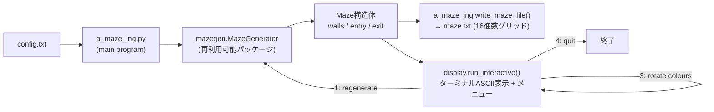
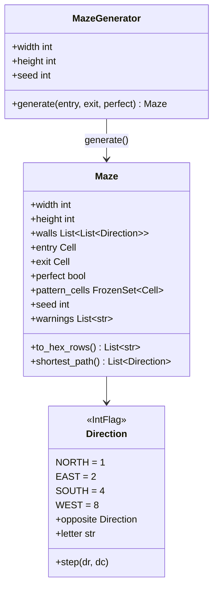
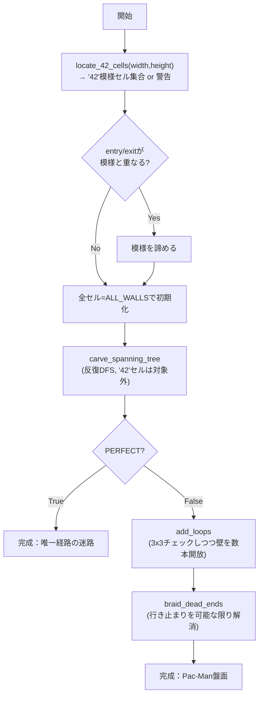

# A-Maze-ing — 要件定義

42 Tokyo cursus 課題 `A-Maze-ing`（`en.subject.pdf`, version 2.3）の要件整理。
このファイルは **提出物ではなく**、実装前に要件を可視化するための内部ドキュメント。
実装は `repo/` に置き、`repo/README.md` に正式なドキュメントがある。

## 1. 全体像



## 2. 必須要件（Mandatory part）

| # | 要件 | 対応 |
|---|---|---|
| 1 | `python3 a_maze_ing.py config.txt` で起動 | `a_maze_ing.py` |
| 2 | config.txt は `KEY=VALUE`、`#` 始まりはコメント | `a_maze_ing.read_config`（python-dotenv） |
| 3 | 必須キー: WIDTH, HEIGHT, ENTRY, EXIT, OUTPUT_FILE, PERFECT | 欠けていれば `ValueError` → `Configuration error` |
| 4 | 全エラーを握りつぶさず、分かりやすいメッセージで非クラッシュ | 全箇所 try/except + カスタム例外 |
| 5 | 迷路は乱数生成だがseedで再現可能 | `MazeGenerator(seed=...)` |
| 6 | 各セルは北/東/南/西の壁0〜4枚 | `Direction` (IntFlag, 4bit) |
| 7 | entry/exitが存在し、違う場所、盤面内 | `_validate_endpoints` |
| 8 | "42"模様を除き全セルが連結、孤立セルなし | 全域木を "42" 以外の全セルに対して構築 |
| 9 | 外周は壁で閉じている | 盤面外との壁は初期値のまま開けない |
| 10 | 壁の符号化は隣接セル間で矛盾しない | 両側のビットを同時に操作するので自動的に整合 |
| 11 | 3x3以上の開けた空間を作らない（最大2x3/3x2） | `_would_make_big_room` で3x3窓を毎回チェック |
| 12 | 中央に閉じたセルで描く"42"模様 | `mazegen/pattern.py`（3x5ドットフォント） |
| 13 | 小さすぎる場合は模様省略＋コンソールに警告 | `locate_42_cells()` が `None` ではなく警告文字列を返す |
| 14 | PERFECT=True: 唯一経路（ループ無し） | スパニングツリーそのまま出力 |
| 15 | PERFECT=False（既定）: Pac-Man盤面として使える | ループ追加＋ブレイディング |
| 15a | 全経路が到達可能 | スパニングツリーで保証 |
| 15b | 四隅と中央が開いた通路 | 中央="42"の隙間列に重なるよう配置、四隅は常にcarvable |
| 15c | 独立経路が2つ以上（ループ） | `_add_loops` |
| 15d | 行き止まりは稀（0ならボーナス） | `_braid_dead_ends` で可能な限りゼロに |
| 16 | 出力ファイル: 1セル1桁16進数、行ごとに1行 | `Maze.to_hex_rows()` |
| 17 | ビット: bit0=North,1=East,2=South,3=West（閉=1） | `mazegen/directions.py` |
| 18 | 空行の後にentry座標・exit座標・最短経路(N/E/S/W) | `a_maze_ing.write_maze_file` |
| 19 | 全行末尾に `\n` | 同上 |
| 20 | 視覚表示（ターミナルASCII or MLX） | `display.py`（ASCII） |
| 21 | 入力中の操作: 再生成／経路表示切替／壁色変更 | `display.run_interactive` のメニュー |

## 3. データモデル



## 4. 迷路生成アルゴリズム



## 5. 出力ファイルフォーマット

```
<16進数グリッド 1行=1row>
...

<entry x,y>
<exit x,y>
<最短経路 N/E/S/W の文字列>
```

- 1セル1桁の16進数。ビットが立っている=壁が閉じている。
- 検証は42提供の `maze_analyzer.py`（`amazing/maze_analyzer.py`）で行う。

## 6. 再利用可能パッケージ（Chapter VI）

- `mazegen` パッケージとして `repo/mazegen/` に実装、`pyproject.toml` で
  `python -m build` し `mazegen-1.0.0-py3-none-any.whl` / `.tar.gz` を
  `repo/` 直下に生成する。
- ドキュメントは `repo/README_mazegen.md`（パッケージに同梱）と
  `repo/README.md`（本体）の両方に記載。
- ライセンス: `repo/LICENSE.md`（MIT）。

## 7. 検証計画

1. `flake8` / `mypy --strict` を0エラーに。
2. `pytest tests/`（非提出・開発用）。
3. 42提供 `maze_analyzer.py` を複数サイズ×PERFECT True/False×複数seedで
   実行し、`Verdict` が期待どおりになることを確認（既定は
   Pac-Man-USABLE、PERFECTはPERFECT maze）。
4. `--max-dead-ends 0` でボーナス（行き止まりゼロ）も確認。
5. 設定エラー系（必須キー欠落・座標範囲外・entry=exit・ファイル無し等）
   が全てクラッシュせず分かりやすいメッセージで終了することを確認。
6. 対話メニュー（再生成／経路表示切替／色変更／不正入力／EOF）の手動確認。
7. `mazegen` のwheelをクリーンなvenvにインストールし、`from mazegen import
   MazeGenerator` が単体で動くことを確認。
8. 実行の様子を動画として記録する（`amazing/demo.mp4`）。

## 8. 想定する非スコープ

- MLXによるグラフィカル表示は実装しない（ターミナルASCIIで要件を満たす）。
- 入力検証は課題が要求する範囲（境界外・型不正・ファイル無し等）に留め、
  それ以上の防御的プログラミングはしない。
